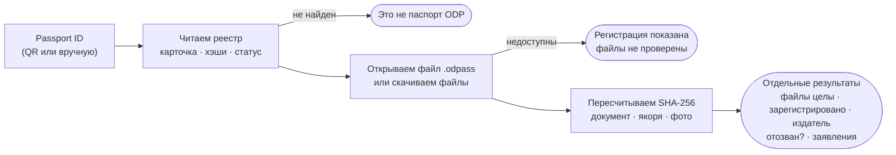
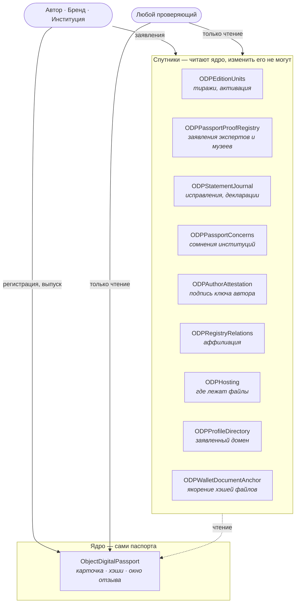

<p align="center">
  
</p>

<h1 align="center">Object Digital Passport</h1>

<p align="center"><b>Бесплатный открытый цифровой паспорт для реальных вещей — искусства, лимитированных изделий, архивов, — который может проверить каждый. Навсегда.</b></p>

<p align="center">
  <a href="LICENSE"></a>
  <a href="SPEC.md"></a>
  <a href="https://github.com/object-digital-passport/specifications/actions/workflows/ci.yml"></a>
  <a href="https://object-digital-passport.github.io/"></a>
  <a href="https://github.com/object-digital-passport/specifications/wiki"></a>
  <a href="https://github.com/object-digital-passport/specifications/discussions"></a>
</p>

<p align="center">
  🇬🇧 <a href="README.md">English</a> · 🇷🇺 Русский — хотите другой язык? <a href="https://github.com/object-digital-passport/specifications/discussions">Напишите в Discussions</a>
</p>

---

## Что это?

**Object Digital Passport (ODP)** даёт физическому или цифровому объекту паспорт, который доказывает три вещи:

1. **Когда** объект был зарегистрирован — метка времени блокчейна, которую нельзя подделать задним числом;
2. **Кто** его зарегистрировал — публичный ID профиля, который можно сверить с официальным сайтом издателя;
3. **Что описание с тех пор не менялось** — криптографические отпечатки каждого фото, размера и отличительной особенности.

Без компании-посредника. Без подписки. Проверка **всегда бесплатна** и будет работать и через 50, и через 100, и через 250 лет — потому что реестр живёт в публичном блокчейне (Polygon), а не на чьём-то сервере. **Что это обещание значит:** развёрнутый реестр отвечает столько, сколько живёт сеть. **Чего оно не значит:** что один адрес обслуживает все поколения — каждая линия `v0.x` это отдельный реестр, и паспорта между ними не мигрируют, поэтому паспорт вечно проверяется против *своей* линии (SPEC.md §7). Регистрация стоит только сетевую комиссию (~$0.01–0.03). Сам протокол не берёт **ничего и никогда**. Всё под лицензией MIT.

**Цель: сделать подделку истории объекта максимально трудной — за копейки.**

> 🟢 **v0.7 работает в Polygon mainnet с 25 сентября 2026** — [заметка о релизе](docs/releases/v0.7.md) (англ.), [адреса](docs/GUIDE.md#current-release), исходный код всех десяти контрактов [верифицирован на Polygonscan](https://polygonscan.com/address/0x3281492981DCD492cc2F7c17398134e1D3B5CA1F#code). Страница проверки и демо ниже пока читают прежний реестр (v0.6), пока их не переведут на v0.7.

> ⚠️ **Статус Alpha:** контракт ещё может меняться между версиями 0.x, что может затронуть ранние паспорта и аккаунты. Для долгосрочного использования дождитесь стабильной версии — цель: **январь 2027**.

---

> ## 🙋 Мы ищем людей — да, именно вас
>
> Теперь честная часть. Я — **Андрей Черников**: современный художник, предприниматель и архивист, занимающийся семейной генеалогией. Я делаю этот проект **полностью один и без образования программиста: это чистый вайбкодинг** — разработка с помощью ИИ, где направление задаёт продуктовое видение, а не инженерный диплом.
>
> Именно поэтому проекту нужны **настоящие люди**: разработчики — проверить и укрепить существующее, тестировщики — сломать его, дизайнеры, переводчики, художники и коллекционеры — испытать на реальных объектах, и скептики — сказать, где мы неправы.
>
> Не нужно быть экспертом по блокчейну. Если эта страница вас зацепила — задача для вас найдётся: начните с [**Discussions → «We need your help!»**](https://github.com/object-digital-passport/specifications/discussions) или просто откройте issue.
>
> **Object Digital Passport — для людей и силами людей.** С настоящим сообществом вокруг мы сделаем мир чуть менее подделываемым.

---

## Попробовать за 2 минуты

- **Проверить объект** — откройте [**страницу проверки**](https://object-digital-passport.github.io/verify.html), введите Passport ID или перетащите файл `.odpass`. Без кошелька и бесплатно.
- **Создать первый паспорт** — [**Быстрый старт**](https://github.com/object-digital-passport/specifications/wiki/Quick-Start-ru) проведёт по шагам (достаточно отдельного кошелька и пары центов POL).
- **Просто осмотреться** — [**живое демо**](https://object-digital-passport.github.io/) со всем интерфейсом прямо в браузере.

> Страница проверки, быстрый старт и демо пока работают с прежним реестром (v0.6) и более ранними. Перевод на v0.7 — следующий шаг.

---

## Как это работает — простыми словами

При регистрации вы получаете **публичный ID профиля** (вида `C-482-930-174-005`). Вы публикуете его вместе с адресом кошелька на своём сайте или в соцсетях — так люди понимают, что ID действительно ваш. Это не пожелание: на этом держится вся модель доверия, поэтому в v0.7 это обязательно для каждого издателя.

Оформляя паспорт объекта, вы описываете его так, как музеи и полиция описывают вещи для опознания (принцип [Object ID](https://icom.museum/en/resources/standards-guidelines/objectid/)): фотографии, размеры, материалы и **отличительные особенности**, которые подделщику трудно повторить, — та самая заштопанная прореха, тот меловой штрих на подрамнике. В v0.7:

- небольшая читаемая **карточка** (название, автор, краткое описание) лежит прямо в блокчейне и никогда не меняется — объект понятен даже без файла;
- все идентификационные факты собраны в одном блоке **`anchors[]`** с отпечатком в блокчейне — и без жёсткого минимума (фото + размеры + материалы + отличительные особенности) паспорт *вообще не зарегистрируется*;
- паспорт — это **факт регистрации, а не дневник**: реестр записывает, кто что зарегистрировал и когда. Исправления, мнения экспертов и сомнения — отдельные подписанные заявления рядом: их можно добавить, но нельзя переписать;
- ошибку можно **отозвать только в короткий срок** — 72 часа для частных лиц, 24 часа для брендов, экспертов и музеев, — а перед печатью этикетки издатель закрывает это окно навсегда;
- можно опубликовать **облегчённую копию главного фото** (без данных о местоположении): её видит и проверяет по реестру любой, а полноразмерный оригинал остаётся в вашем файле;
- бренд может охватить **весь тираж** одной регистрацией, и у каждого экземпляра свой ключ под скретч-слоем.

Полное описание живёт в переносимом файле **`.odpass`**, который вы храните и передаёте; блокчейн хранит его отпечатки. Измените одну запятую — отпечаток перестанет совпадать, и это увидит каждый проверяющий.

ODP показывает **отдельные результаты**, а не одну печать «подлинно»: файлы целы, зарегистрировано в реестре, кто издатель (сверьте его ID профиля с тем, что он публикует сам), отозван ли паспорт, заявления экспертов. Настоящую этикетку можно перенести на подделку, поэтому ODP всегда просит сравнить предмет с фото и описанием. ODP — инструмент в руках человека, а не волшебная палочка: он делает подделку дорогой и заметной и даёт экспертам, покупателям и институциям одни и те же защищённые от подмены факты.

### Что на самом деле делает проверка



Каждый шаг — только чтение и бесплатно: без кошелька, без аккаунта, без разрешения от нас. Полный алгоритм — [`SPEC.md` §11](SPEC.md), что обязано показывать приложение — [§22.16](SPEC.md).

---

## Как это устроено внутри

В реестре никто не главный: нет администратора, нет выключателя, нет владельца. Ядро только записывает регистрации. Всё необязательное живёт в девяти **спутниках** — отдельных контрактах, которые читают ядро и никогда не могут в него писать.



Реестр в Polygon mainnet: [`0x3281492981DCD492cc2F7c17398134e1D3B5CA1F`](https://polygonscan.com/address/0x3281492981DCD492cc2F7c17398134e1D3B5CA1F). Все десять адресов — [`docs/GUIDE.md` → Current Release](docs/GUIDE.md#current-release).

---

## Запустить у себя

Контракты и эталонные инструменты:

```bash
cd chain && npm ci && npx hardhat clean && npm run check
```

Команда компилирует контракты на Solidity 0.8.20, проверяет ограничение размера, эталонные векторы и запускает локальные тесты. Сайт-пример живёт в отдельном репозитории: [object-digital-passport.github.io](https://github.com/object-digital-passport/object-digital-passport.github.io).

---

## Для кого это?

| Префикс | Тип аккаунта | Кто |
|---|---|---|
| **C** | Автор | Художники, фотографы, мастера — уникальные объекты |
| **B** | Бренд | Студии и бренды, выпускающие продукцию, — единственный тип, который может выпускать целый тираж |
| **P** | Проверяющая институция | Галереи, аукционные дома, экспертные организации, публикующие заявления об объектах |
| **M** | Музей | Музеи и крупные коллекции, включая работы ушедших авторов |

Тип выбирается самостоятельно, аккредитации нет — любой может выбрать любой. Поэтому ищите, кто стоит за ID профиля, на собственных каналах издателя: «музейный» аккаунт, оформляющий паспорт на новую работу живого художника, — ваш первый красный флаг 🚩

---

## Вопросы и ответы

**Зачем мне это?**
Защитить свои работы от подделок — и собрать «неразрушимый» каталог сделанного, с доказательством «когда».

**Нужно ли разбираться в крипте?**
Только основы: поставить свой кошелёк (приложения ODP никогда не создают и не хранят его за вас), сохранить фразу восстановления — никто, включая нас, не сможет её восстановить, — и пополнить немного POL на сетевые комиссии. Заведите отдельный кошелёк под ODP — не тот, где сбережения. Для проверки паспорта кошелёк не нужен вообще.

**Что будет, если сайт проекта исчезнет?**
Паспорта переживут его. Реестр — в публичном блокчейне, код — под MIT: любой может поднять свой верификатор. В этой независимости весь смысл.

**Можно ли потом отредактировать паспорт?**
Карточку — никогда. Именно поэтому ему можно верить. Ошибку можно отозвать в течение 72 часов (частные лица) или 24 часов (организации), если издатель ещё не зафиксировал паспорт для печати. После этого исправление — это новый паспорт или подписанное заявление рядом со старым. Ничего не переписывается.

**Сколько это стоит?**
Небольшая сетевая комиссия в POL за каждую регистрацию или паспорт; её определяет сеть Polygon, а не мы. Проверка бесплатна. Сам стандарт комиссию не берёт — принципиально и навсегда.

**Где техническая часть?**
Начните с [**вики**](https://github.com/object-digital-passport/specifications/wiki/Home-ru) — там всё человеческим языком, — а затем нормативная база: [`SPEC.md`](SPEC.md) (англ.; [русский перевод](docs/ru/SPEC.md) справочный).

---

## 📚 Узнать больше

| Где | Что |
|---|---|
| [**Вики**](https://github.com/object-digital-passport/specifications/wiki/Home-ru) | Дружелюбные гайды: быстрый старт, как работает проверка, NFC-пломбы, Object ID, FAQ — 🇬🇧/🇷🇺 |
| [`SPEC.md`](SPEC.md) | Полная спецификация протокола (нормативная, англ.) |
| [`docs/GUIDE.md`](docs/GUIDE.md) | Подробный длинный гайд ([русская версия](docs/ru/GUIDE.md)) |
| [`docs/releases/v0.7.md`](docs/releases/v0.7.md) | Что нового в v0.7 (заметка о релизе, англ.) |
| [`CHANGELOG.md`](CHANGELOG.md) | Заметные изменения по линиям протокола (англ.) |
| [`docs/SECURITY.md`](docs/SECURITY.md) | Модель угроз ([по-русски](docs/ru/SECURITY.md)) |
| [`docs/CONTRIBUTING.md`](docs/CONTRIBUTING.md) | Как участвовать ([по-русски](docs/ru/CONTRIBUTING.md)) |
| [Живое демо →](https://object-digital-passport.github.io/) | Попробовать всё онлайн (пока на реестре v0.6) |

**Структура репозитория:** [`SPEC.md`](SPEC.md) — стандарт · [`chain/`](chain/) — контракты и тесты · [`schema/`](schema/) — схема и векторы · [`docs/`](docs/) — документация · [`review/`](review/) — материалы аудита и утверждённый release-бандл. Сайт-пример живёт в отдельном репозитории: [object-digital-passport.github.io](https://github.com/object-digital-passport/object-digital-passport.github.io).

---

<p align="center">
  <b>💬 <a href="https://github.com/object-digital-passport/specifications/discussions">Присоединяйтесь к обсуждению</a></b> — зайдите в тему <b>«We need your help!»</b>, и мы найдём задачу, где ваш вклад будет самым ценным.<br><br>
  Спасибо, что дочитали. Если хотите помочь — или знаете того, кому это может быть интересно, — <b>мы вас ждём!</b>
</p>
